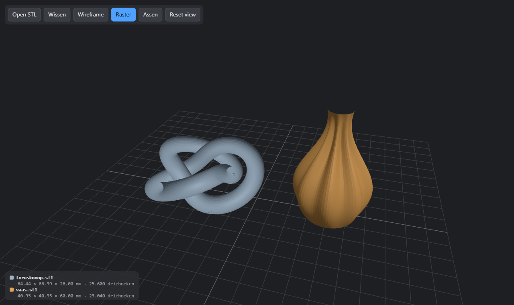

# STL Viewer

Een simpele STL-viewer in één HTML-bestand, gebouwd met [three.js](https://threejs.org/).



**Online gebruiken:** https://gasille.github.io/simpel-stl-viewer/

Je bestanden blijven op je eigen computer: de viewer leest ze in de browser en uploadt niets.

## Gebruik

1. Open de [online viewer](https://gasille.github.io/simpel-stl-viewer/), of open `index.html` lokaal in een browser (dubbelklikken is genoeg).
2. Klik op **Open STL** of sleep een of meer `.stl`-bestanden in het venster.

Meerdere modellen worden naast elkaar gezet, op dezelfde schaal en elk in een eigen kleur.

- **Linkermuisknop**: draaien
- **Rechtermuisknop**: verschuiven
- **Scrollwiel**: zoomen
- Knoppen: Wissen, Wireframe, Raster, Assen, Reset view

Linksonder staan per model de afmetingen (mm) en het aantal driehoeken.
Binaire en ASCII-STL worden allebei ondersteund.

> three.js wordt van jsdelivr geladen, dus je hebt een internetverbinding nodig.

## Modellen inbedden

Een browser mag een `.stl` niet zelf van schijf laden. Wil je een pagina die een
model meteen toont, zet dan vóór `<script type="importmap">` een script dat
`window.STL_EMBED` vult:

```html
<script>
  window.STL_EMBED = [
    { name: "model.stl", base64: "<base64 van het STL-bestand>" }
  ];
</script>
```

Eén object in plaats van een lijst mag ook.

## Licentie

[MIT](LICENSE). three.js valt onder zijn eigen MIT-licentie.
